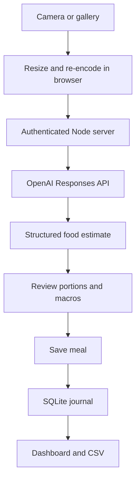

# MacroLens

### A clearer picture of your plate.

A personal, photo-first nutrition journal built for everyday use on Android. Photograph a meal, review the estimated portions and macros, and save it to an editable journal. Track calorie and protein targets without hiding the assumptions behind the numbers.


**Status:** runnable v0.1 source. Automated tests pass locally. A live OpenAI request, browser layout, Samsung camera, and home-screen installation still need device verification. No hosting deployment is included in this first commit.

## What it does

- **Today:** calorie intake, remaining calories, protein progress, and meal summaries.
- **Add a meal:** camera or gallery upload, optional context, editable foods and full-portion macros, and explicit confirmation before saving.
- **Food log:** spreadsheet-style food rows, search, date filters, editing, deletion, and repeat-a-meal drafts.
- **Trends:** seven-day calorie chart, historically correct targets, logged-day averages, and weight history.
- **Goals:** maintenance estimate, chosen deficit, protein target, dated target changes, and weight entries.
- **Your data:** SQLite persistence, CSV export, and complete JSON export of meals, targets, and weight entries.
- **Demo workspace:** sample meals and a clearly labelled sample estimate. Demo changes are in memory and reset on reload. It never calls OpenAI or writes to your private journal.
- **Android installation:** web app manifest, home-screen icons, and a network-only service worker.

## Run it

Install **Node.js 24 or later**, then:

```bash
git clone https://github.com/AkshayDubey03/macrolens.git
cd macrolens
npm start
```

Open **http://127.0.0.1:3000**. No package installation or build step is needed. By default this is a sample-data demo; private storage and AI routes remain inaccessible.

To enable your personal journal:

```bash
cp .env.example .env
```

Edit `.env` on your machine:

```dotenv
APP_PASSWORD=replace-with-your-own-long-random-password
OPENAI_API_KEY=your-own-api-key
OPENAI_MODEL=gpt-4.1-mini
```

Use a password with **at least 12 characters**. Restart with `npm start`, then choose **Sign in**. An API key is optional for manual logging; photo analysis requires a funded API project and an image-capable model supporting Structured Outputs. The example model is configurable, not a promise of account access or future availability. Do not paste credentials into GitHub files or issues.

Personal mode starts empty. Demo meals are never copied into it. Set your own targets in Goals, then add a manual meal or a photo.

### Use it on your Samsung

1. Run this server on a host with **HTTPS** and a **persistent data volume**. A GitHub repository stores source code; it does not run this Node/SQLite backend. GitHub Pages alone is insufficient.
2. Set `HOST=0.0.0.0`, a strong `APP_PASSWORD`, `COOKIE_SECURE=true`, and optional OpenAI credentials in your host's environment settings. Terminate HTTPS at the hosting provider or reverse proxy.
3. Open the hosted URL in Chrome on your Samsung, sign in, and use **⋮ → Add to Home screen / Install app**. The precise wording depends on the browser.
4. Open MacroLens from its home-screen icon. Camera/gallery selection and AI analysis need device testing; AI analysis requires internet.

For testing over your home Wi-Fi, `HOST=0.0.0.0` makes the server reachable at the computer's LAN IP. HTTP on a LAN can open the page, but secure-context PWA/camera features may be restricted. Use HTTPS for normal phone use. Never expose an unencrypted personal journal publicly.

The service worker does **not** cache journal data. Offline logging and receiving photos through Android's share sheet are not implemented yet.

### Docker

```bash
docker build -t macrolens .
docker run --rm -p 3000:3000 --env-file .env -e HOST=0.0.0.0 -v macrolens-data:/app/.data macrolens
```

Use HTTPS in front of the container for public hosting. Keep the volume: deleting it removes your journal. Set `COOKIE_SECURE=true` when the public URL uses HTTPS. Port and data directory are configurable. Health endpoint: `GET /health`.

## How photo analysis works



Photos are resized to a maximum edge of 1600 pixels and re-encoded as JPEG in the browser. Clicking **Analyse photo** sends that image and the supplied meal context to OpenAI through the server. The API key stays on the server. `store: false` is used for Responses; this is not a claim of zero data retention by the API provider.

The model returns a strict JSON schema with foods, portions, calories, protein, carbs, fat, and concrete assumptions. The server validates those results. The estimate remains a draft until you explicitly save it. No meal photo is saved in SQLite, cached by the service worker, or committed to Git.

In v0.1, AI estimates are **not verified against a nutrition database**. Manual entries should use labels, weighed portions, or a trusted nutrition reference. Hidden oil, serving size, and mixed recipes are uncertain from photos. Numeric precision is not measurement accuracy.

## Transparent calculations

| Value | Calculation |
| --- | --- |
| Calorie target | Your maintenance estimate − your chosen deficit |
| Calories remaining | That day's target − logged calories |
| Protein remaining | Maximum of zero and protein target − logged protein |
| Daily macros | Sum of each food's values for the full consumed portion |
| Target for a past day | Most recent target with an effective date on or before that day |
| Seven-day average | Logged days only; these can still be incomplete days |

This app does not measure energy expenditure or actual deficit. Maintenance and protein targets are currently user-entered; automatic maintenance estimation and recommended targets are future work. Dates use the device's local calendar date. A repeated meal opens as a new draft rather than saving immediately.

## Architecture and privacy

- **Frontend:** browser-native JavaScript modules, semantic HTML, responsive CSS, SVG charts. No frontend framework or CDN fonts.
- **Backend:** Node's HTTP server, built-in `fetch`, and built-in SQLite (`node:sqlite`). No third-party runtime dependencies.
- **Persistence:** one versioned journal document in SQLite with an atomic revision check. An outdated tab receives a conflict rather than silently overwriting newer edits. Keep a single server instance on a local persistent disk; horizontal scaling is outside this version's scope.
- **Authentication:** single-owner app password, signed HttpOnly/SameSite cookies, seven-day expiry, and login throttling. Server restart invalidates sessions. This is not a multi-user account system.
- **Boundaries:** exact static asset allowlist, same-origin write checks, restrictive content security policy, input/body limits, escaped UI text, and CSV formula neutralization.
- **AI limits:** default 20 analysis attempts per UTC day, persisted in SQLite. `AI_DAILY_LIMIT` controls the application cap. Configure provider-side usage controls too; this app cap is not a monetary guarantee.
- **Storage:** `.data/journal.sqlite` is private runtime data and ignored by Git. Back up the volume and use app exports. Exported files contain personal nutrition data; keep them private. JSON import is not yet implemented.

If hosting for others, add proper user accounts, per-user authorization, individual quotas, and operational monitoring before collecting anyone else's data. Never use the public demo as a shared personal journal.

## Development

```bash
npm run dev
npm run check
npm test
```

`npm run dev` watches server files. Reload the browser after frontend changes. Tests use Node's test runner, temporary databases, and mocked OpenAI responses; they never spend API credits.

| File | Responsibility |
| --- | --- |
| `public/app.js` | Screens, meal editor, demo state, authenticated API calls |
| `public/styles.css` | Visual design and Android/desktop layouts |
| `lib/domain.mjs` | Validation, totals, dated targets, CSV export |
| `lib/vision.mjs` | Image validation, analysis prompt, response schema |
| `server.mjs` | Authentication, storage, API routes, static asset serving |
| `test/` | Domain, server, persistence, security boundaries, AI contract tests |
| `.github/workflows/ci.yml` | Node 24 syntax checks and automated tests |

Edit from a local checkout, VS Code, or a GitHub Codespace. Secrets belong in the development environment's secret settings or your local ignored `.env`. A public Codespace port must not expose a configured private journal over HTTP. Phone-side GitHub edits are possible for small changes; a computer is more practical for development.

### Next milestones

- [ ] Verify UI, food camera, and installation on a Samsung phone
- [ ] Connect a personal API project and measure cost/latency on real meals
- [ ] Add nutrition-database matching and label/barcode workflows
- [ ] Add saved recipes and portion weights
- [ ] Add tested backup restoration
- [ ] Add offline drafts and Android share-target support
- [ ] Add real device screenshots and a short portfolio walkthrough

## References

- [OpenAI image inputs](https://developers.openai.com/api/docs/guides/images-vision)
- [OpenAI Structured Outputs](https://developers.openai.com/api/docs/guides/structured-outputs)
- [Node.js SQLite](https://nodejs.org/api/sqlite.html)
- [PWA installation](https://web.dev/learn/pwa/installation)

Copyright © 2026 AkshayDubey03. No open-source license has been selected yet.
